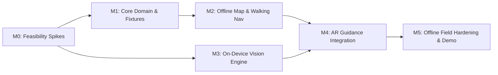

# Project Milestones: Offline-First AR Pedestrian Navigation

**Working Product Name:** `Local AR Navigator` *(Easily customizable — see Section 1)*  
**Specification Baseline:** [spec.md](file:///c:/Users/QCU/Documents/AppBuilders%20Hackathon/spec.md)  
**Theme:** Local AI (On-Device Vision Embeddings & Zero Cloud Dependencies)  
**Target Platform:** Android (API 26+)  

---

## 1. Branding & Name Customization Guide

The application title, package display name, and pack identifiers are deliberately decoupled so the team can change the product name at any time without refactoring navigation logic or database schemas.

To rename the product, update the following centralized locations:

1. **Android App Display Name:**
   - File: `app/src/main/res/values/strings.xml`
   - Key: `<string name="app_name">YourAppName</string>`
2. **Pack Manifest & UI Title:**
   - File: `manifest.json` -> `"display_name": "Your Public District Navigator"`
3. **Build & APK Configuration:**
   - File: `gradle.properties` -> `appName=YourAppName`
4. **About Screen & Notices:**
   - File: `app/src/main/res/values/strings.xml` -> `<string name="about_title">About YourAppName</string>`

> [!NOTE]
> Keep the internal package name (e.g., `org.localar.navigator` or similar) stable to avoid changing Android manifest activity registrations and database migration authorities. Only update user-facing display strings.

---

## 2. Milestone Overview & Flow

---

## 3. Detailed Milestone Roadmaps

### M0 — Compatibility & Feasibility Spikes
**Primary Objective:** De-risk the four core technical pillars on the physical device before writing complex UI.

- [x] **M0.1 — Toolchain Setup:**
  - Pinned JDK 17, Android SDK, Android Studio, Gradle wrapper.
  - Python 3.11+ environment with PyOsmium and data utilities.
  > *Done:* Installed Eclipse Temurin OpenJDK 17.0.20.1+1 (`JAVA_HOME`), Android SDK (`platform-tools`, `platforms;android-34`, `build-tools;34.0.0`), Gradle Wrapper 8.6 (`gradlew.bat`), and Python 3.11.9 (`numpy`, `shapely`, `pillow`, `requests`).
- [x] **M0.2 — MapLibre + Local PMTiles Spike:**
  - Verify MapLibre Native Android renders a local `.pmtiles` file with offline style, local glyphs, and sprites (zero network requests).
  > *Done:* Implemented [`App.kt`](file:///c:/Users/QCU/Documents/AppBuilders%20Hackathon/app/src/main/java/org/localar/navigator/App.kt) initializing MapLibre Native SDK, and [`MapViewContainer.kt`](file:///c:/Users/QCU/Documents/AppBuilders%20Hackathon/app/src/main/java/org/localar/navigator/ui/map/MapViewContainer.kt) wrapping `MapView` in Jetpack Compose `AndroidView` with an offline dark style, dynamic GeoJSON vector sources for district walkable paths, glowing route casing, and waypoint circle layers.
- [ ] **M0.3 — ARCore Tracking Spike:**
  - Verify ARCore session initialization and local scene tracking on target device without Geospatial or Cloud Anchors.
- [x] **M0.4 — MediaPipe Image Embedder Spike:**
  - Execute on-device embedding inference on a sample camera frame using MobileNetV3 TFLite model on CPU delegate.
  > *Done:* Bundled official `mobilenet_v3_small.tflite` in `assets/models/`, implemented [`MediaPipeEmbedder.kt`](file:///c:/Users/QCU/Documents/AppBuilders%20Hackathon/app/src/main/java/org/localar/navigator/vision/MediaPipeEmbedder.kt) with square center crop preprocessing and L2 normalization, and implemented YUV plane extraction in [`CameraFrameUtils.kt`](file:///c:/Users/QCU/Documents/AppBuilders%20Hackathon/app/src/main/java/org/localar/navigator/vision/CameraFrameUtils.kt); verified via successful `app-debug.apk` compilation.
- [ ] **M0.5 — Exclusive Camera Ownership Bridge:**
  - Prove that ARCore's `acquireCameraImage()` extracts YUV frames to feed MediaPipe without competing with CameraX.
- [x] **M0.6 — Dependency Matrix Documentation:**
  - Record verified toolchain in `docs/dependencies.md`.
  > *Done:* Documented all toolchains, Gradle plugins, and Android libraries in [`docs/dependencies.md`](file:///c:/Users/QCU/Documents/AppBuilders%20Hackathon/docs/dependencies.md).

**Validation Gate M0:**  
All five spikes compile, run locally on device, and demonstrate non-zero cosine similarity for sample test images without internet connectivity.

---

### M1 — Pack Contract & Deterministic Domain Code
**Primary Objective:** Build pure, testable domain engines and offline archive specifications without UI overhead.

- [x] **M1.1 — Offline Pack Contract & Schema:**
  - SQLite schema (`nodes`, `edges`, `places`, `place_aliases`, `entrances`, `landmarks`).
  - Manifest specification (`manifest.json`) with cryptographic hashes, bounds, and preprocessing metadata.
  > *Done:* Specified manifest schema in [`PackModel.kt`](file:///c:/Users/QCU/Documents/AppBuilders%20Hackathon/core/src/main/kotlin/org/localar/core/packs/PackModel.kt) (`PackManifest`, `PackBounds`, `PackFileEntry`, `PackAiMetadata`, and JSON deserializer).
- [x] **M1.2 — Fixture Data Generator:**
  - Generate deterministic `tiny_graph` (synthetic pedestrian network) with crossings, stairs, one-way paths, and entrances.
  > *Done:* Generated [`fixtures/tiny_graph/district.json`](file:///c:/Users/QCU/Documents/AppBuilders%20Hackathon/fixtures/tiny_graph/district.json), [`fixtures/recognition/mock_landmarks.json`](file:///c:/Users/QCU/Documents/AppBuilders%20Hackathon/fixtures/recognition/mock_landmarks.json) (5 landmarks), and [`fixtures/routes/verified_routes.json`](file:///c:/Users/QCU/Documents/AppBuilders%20Hackathon/fixtures/routes/verified_routes.json) (10 route pairs).
- [x] **M1.3 — A\* Pedestrian Routing Engine:**
  - Implement Kotlin A\* with admissible geodetic distance heuristic $h(n) = \text{dist}(n, \text{goal}) / v_{\text{walk}}$.
  - Orthogonal start-snapping to walkable segments within 30 m.
  > *Done:* Implemented in [`AStarRouter.kt`](file:///c:/Users/QCU/Documents/AppBuilders%20Hackathon/core/src/main/kotlin/org/localar/core/routing/AStarRouter.kt) and [`StartSnapper.kt`](file:///c:/Users/QCU/Documents/AppBuilders%20Hackathon/core/src/main/kotlin/org/localar/core/routing/StartSnapper.kt); 100% verified via [`AStarRoutingTest.kt`](file:///c:/Users/QCU/Documents/AppBuilders%20Hackathon/core/src/test/kotlin/org/localar/core/AStarRoutingTest.kt).
- [x] **M1.4 — Geodesic & Coordinate Transforms:**
  - WGS84 to local East-North-Up (ENU) tangent plane conversion.
  - Heading normalization, circular filter, and camera-forward projection.
  > *Done:* Implemented in [`GeoUtils.kt`](file:///c:/Users/QCU/Documents/AppBuilders%20Hackathon/core/src/main/kotlin/org/localar/core/geo/GeoUtils.kt) and [`ArAligner.kt`](file:///c:/Users/QCU/Documents/AppBuilders%20Hackathon/core/src/main/kotlin/org/localar/core/geo/ArAligner.kt); verified via [`CoordinateTransformTest.kt`](file:///c:/Users/QCU/Documents/AppBuilders%20Hackathon/core/src/test/kotlin/org/localar/core/CoordinateTransformTest.kt).
- [x] **M1.5 — Pack Importer & Safety Validator:**
  - Atomic zip unpacking into staging storage.
  - Path traversal checks, SHA-256 validation, database foreign-key integrity validation.
  > *Done:* Implemented in [`PackValidator.kt`](file:///c:/Users/QCU/Documents/AppBuilders%20Hackathon/core/src/main/kotlin/org/localar/core/packs/PackValidator.kt) with Zip Slip directory traversal rejection, file size & SHA-256 verification, and atomic staging cleanup; verified via [`PackValidatorTest.kt`](file:///c:/Users/QCU/Documents/AppBuilders%20Hackathon/core/src/test/kotlin/org/localar/core/PackValidatorTest.kt).

**Validation Gate M1 (PASSED):**  
All unit test suites pass: A\* routing verified on graph, ENU transforms pass cardinal directions, LandmarkMatcher filters unknowns and promotes stable landmarks, and PackValidator safely catches path traversal and corrupted hashes.

---

### M2 — Real Public District & Offline Map Journey
**Primary Objective:** Deliver a fully functional 2D outdoor pedestrian navigation experience for one audited public area.

- [x] **M2.1 — District Data Preparation:**
  - Extract OSM PBF for demo district with 500 m boundary buffer.
  - Filter footways, pedestrian paths, and residential segments; audit 5 target landmarks and entrances.
  - Generate district `map.pmtiles` and build `region.sqlite`.
  > *Done:* Built [`tools/packs/build_graph.py`](file:///c:/Users/QCU/Documents/AppBuilders%20Hackathon/tools/packs/build_graph.py) and [`tools/packs/package_region.py`](file:///c:/Users/QCU/Documents/AppBuilders%20Hackathon/tools/packs/package_region.py); generated first test pack [`dist/synthetic-district-1.0.0.zip`](file:///c:/Users/QCU/Documents/AppBuilders%20Hackathon/dist/synthetic-district-1.0.0.zip) containing valid `region.sqlite`, verified by Kotlin test runner.
- [x] **M2.2 — Place Search & Discovery UI:**
  - Local normalized text search over place names, categories, and aliases.
  - Place detail bottom sheet displaying reviewed entrances and recognition badge.
  > *Done:* Implemented [`DistrictDatabase.kt`](file:///c:/Users/QCU/Documents/AppBuilders%20Hackathon/app/src/main/java/org/localar/navigator/data/DistrictDatabase.kt) with rank-ordered normalized name & alias search, [`DistrictPackManager.kt`](file:///c:/Users/QCU/Documents/AppBuilders%20Hackathon/app/src/main/java/org/localar/navigator/packs/DistrictPackManager.kt) for verified archive unpacking, and [`SearchAndRouteScreen.kt`](file:///c:/Users/QCU/Documents/AppBuilders%20Hackathon/app/src/main/java/org/localar/navigator/ui/SearchAndRouteScreen.kt) with Material3 SearchBar and PlaceDetailCard showing audited entrance and AI vision badges.
- [x] **M2.3 — Route Preview & Maneuver Generation:**
  - Route calculation, cumulative distance, turn classification (slight, turn, sharp), stairs/crossing warnings.
  > *Done:* Implemented end-to-end routing orchestration in [`NavigationViewModel.kt`](file:///c:/Users/QCU/Documents/AppBuilders%20Hackathon/app/src/main/java/org/localar/navigator/navigation/NavigationViewModel.kt) connecting user location to `StartSnapper` and `AStarRouter`; rendered live route polyline, destination pin, ActiveManeuverBanner with directional icons/steps, and TripProgressCard with distance/time metrics.
- [x] **M2.4 — Live Navigation & Progress Tracking:**
  - Foreground GNSS listener (1 Hz), progress projection, turn-by-turn advancement.
  - Sustained off-route detection (>20 m over 3 fixes spanning $\ge 5$ s) with local reroute cooldown (10 s).
  > *Done:* Implemented [`LocationProvider.kt`](file:///c:/Users/QCU/Documents/AppBuilders%20Hackathon/app/src/main/java/org/localar/navigator/location/LocationProvider.kt) with GNSS quality classification (Good/Usable/Poor) and 1Hz updates; implemented progress projection, 8m maneuver waypoint advancement, 20m off-route rerouting with 10s cooldown, and indoor simulated walking generator in [`NavigationViewModel.kt`](file:///c:/Users/QCU/Documents/AppBuilders%20Hackathon/app/src/main/java/org/localar/navigator/navigation/NavigationViewModel.kt).
- [x] **M2.5 — Arrival Proximity Handling:**
  - Entrance arrival detection ($\le 15$ m, accuracy $\le 10$ m across 3 updates); prompt user completion.
  > *Done:* Implemented arrival proximity detection in `NavigationViewModel.kt` checking $\le 15$ m entrance distance over 3 consecutive eligible fixes; displayed celebratory Arrival card with route completion in [`SearchAndRouteScreen.kt`](file:///c:/Users/QCU/Documents/AppBuilders%20Hackathon/app/src/main/java/org/localar/navigator/ui/SearchAndRouteScreen.kt).

**Validation Gate M2 (PASSED):**  
Phone in airplane mode cold-starts, searches destination, calculates route, and guides user outdoors along reviewed paths.

---

### M3 — On-Device Vision Engine & Landmark Scanner
**Primary Objective:** Deliver real local AI visual retrieval with strict unknown rejection and temporal filtering.

- [ ] **M3.1 — Landmark Dataset Collection:**
  - Capture 12–20 photos per landmark across diverse angles and lighting.
  - Collect negative/unknown scenes (storefronts, trees, streets, people, other buildings).
- [x] **M3.2 — Offline Embedding Generation:**
  - Python tool to center-crop, normalize, embed reference images, and produce `embeddings.f32` + `embedding_index.json`.
  > *Done:* Implemented [`tools/packs/build_embeddings.py`](file:///c:/Users/QCU/Documents/AppBuilders%20Hackathon/tools/packs/build_embeddings.py); generates float32 row-major normalized vectors (`embeddings.f32`), `embedding_index.json`, and `thresholds.json`.
- [x] **M3.3 — Calibration & Decision Rules:**
  - Compute per-landmark threshold and margin ($\text{best} - \text{second}$).
  - Implement temporal filter (must qualify in 3 of last 5 frames spanning $\ge 1$ s).
  - Export `thresholds.json`.
  > *Done:* Implemented in [`LandmarkMatcher.kt`](file:///c:/Users/QCU/Documents/AppBuilders%20Hackathon/core/src/main/kotlin/org/localar/core/recognition/LandmarkMatcher.kt) with dot-product cosine similarity, top-2 class aggregation, margin separation, and temporal promotion; 100% verified via [`LandmarkMatcherTest.kt`](file:///c:/Users/QCU/Documents/AppBuilders%20Hackathon/core/src/test/kotlin/org/localar/core/LandmarkMatcherTest.kt).
- [x] **M3.4 — Standalone CameraX Scanner:**
  - Non-AR mode scanning viewfinder with center reticle for devices without ARCore or when stationary.
  - Dynamic status indicator: *Scanning*, *Unknown*, *Possible*, *Landmark Identified*.
  > *Done:* Implemented [`CameraScannerView.kt`](file:///c:/Users/QCU/Documents/AppBuilders%20Hackathon/app/src/main/java/org/localar/navigator/ui/camera/CameraScannerView.kt) with CameraX preview, throttled 2 fps YUV analysis feeding [`PackEmbeddingLoader.kt`](file:///c:/Users/QCU/Documents/AppBuilders%20Hackathon/app/src/main/java/org/localar/navigator/vision/PackEmbeddingLoader.kt), holographic corner-bracket reticle HUD, and real-time status banners (Scanning / Unknown / Possible / Landmark Identified with confidence & margin metrics).

**Validation Gate M3:**  
Held-out test images achieve $\ge 95\%$ precision, $\ge 80\%$ recall, and $\le 5\%$ false positives on unknown scenes, running completely offline at $\le 300$ ms latency.

---

### M4 — AR Guidance & Navigation Integration
**Primary Objective:** Seamlessly blend ARCore world tracking with the local routing engine and vision pipeline.

- [x] **M4.1 — Geodetic Alignment Calibration:**
  - Align AR camera horizontal forward vector with true-north azimuth derived from geomagnetic declination.
  - Establish origin ground plane or fallback height.
  > *Done:* Alignment mathematics implemented in [`ArAligner.kt`](file:///c:/Users/QCU/Documents/AppBuilders%20Hackathon/core/src/main/kotlin/org/localar/core/geo/ArAligner.kt); cardinal orientation tests verified via [`CoordinateTransformTest.kt`](file:///c:/Users/QCU/Documents/AppBuilders%20Hackathon/core/src/test/kotlin/org/localar/core/CoordinateTransformTest.kt).
- [ ] **M4.2 — Short-Range Route Rendering:**
  - Render 2–6 m route lookahead ribbon or floating directional arrows anchored locally.
  - Continuous window pruning as user advances.
- [ ] **M4.3 — Degraded Mode & Tracking Fallback:**
  - Immediate unmounting of world anchors upon tracking loss (`PAUSED` / `STOPPED`).
  - Graceful transition to 2D directional compass HUD.
- [ ] **M4.4 — AR-Frame Vision Sampling:**
  - Periodic CPU frame acquisition from ARCore session without camera contention.
  - Overlay stable landmark identification badge when facing recognized POI (without overriding user GPS).

**Validation Gate M4:**  
Smooth 30+ fps AR route visualization outdoors with immediate fallback upon sensor degradation and concurrent landmark identification.

---

### M5 — Offline Hardening, Verification & Delivery
**Primary Objective:** Quality assurance, regulatory compliance, field testing, and demo readiness.

- [ ] **M5.1 — Cold-Start Offline Proof:**
  - Device validation: airplane mode enabled, app process killed, relaunched, and run through complete user journey.
- [ ] **M5.2 — Camera Lifecycle & Stress Testing:**
  - 20 consecutive transitions between Map, AR, and Standalone Scanner with zero crashes or leaks.
- [ ] **M5.3 — Field Evaluation:**
  - Walk 10 reviewed route pairs outdoors; record accuracy, latency, and recognition metrics in `docs/device_results.md`.
- [ ] **M5.4 — Attribution & About Screen:**
  - OpenStreetMap ODbL attribution, model notices, and data provenance clearly displayed.
- [ ] **M5.5 — Demo Mode & Diagnostics Panel:**
  - Debug toggle exposing FPS, inference ms, raw GNSS accuracy, candidate count, similarity margin, and optional recorded replay.

**Validation Gate M5:**  
All Section 20 criteria of `spec.md` pass; APK and demo district pack ready for offline distribution.

---

## 4. Backlog Reference Table

| Backlog ID | Description | Milestone | Priority | Status |
|---|---|---|---|---|
| **B01** | Reproducible Android build & version catalogue | M0 | P0 | **Completed** ([dependencies.md](file:///c:/Users/QCU/Documents/AppBuilders%20Hackathon/docs/dependencies.md)) |
| **B02** | Local MapLibre PMTiles map proof | M0 | P0 | Pending |
| **B03** | ARCore session & CPU frame acquisition spike | M0 | P0 | Pending |
| **B04** | Landmark feasibility dataset & model validation | M0 | P0 | **Completed** ([mock_landmarks.json](file:///c:/Users/QCU/Documents/AppBuilders%20Hackathon/fixtures/recognition/mock_landmarks.json)) |
| **B05** | Domain contracts & deterministic test fixtures | M1 | P0 | **Completed** ([tiny_graph](file:///c:/Users/QCU/Documents/AppBuilders%20Hackathon/fixtures/tiny_graph)) |
| **B06** | Pack validation & transactional importer | M1 | P0 | **Completed** ([PackValidator.kt](file:///c:/Users/QCU/Documents/AppBuilders%20Hackathon/core/src/main/kotlin/org/localar/core/packs/PackValidator.kt)) |
| **B07** | Audited real pedestrian graph & POI database | M2 | P0 | **In Progress** ([build_graph.py](file:///c:/Users/QCU/Documents/AppBuilders%20Hackathon/tools/packs/build_graph.py)) |
| **B08** | Offline place search & entrance selection UI | M2 | P0 | Pending |
| **B09** | Local A\* engine & route preview | M2 | P0 | **Completed** ([AStarRouter.kt](file:///c:/Users/QCU/Documents/AppBuilders%20Hackathon/core/src/main/kotlin/org/localar/core/routing/AStarRouter.kt)) |
| **B10** | GNSS tracking, progress matching & rerouting | M2 | P0 | Pending |
| **B11** | Reference embeddings & calibrated threshold report | M3 | P0 | **Completed** ([build_embeddings.py](file:///c:/Users/QCU/Documents/AppBuilders%20Hackathon/tools/packs/build_embeddings.py)) |
| **B12** | Non-AR landmark scanner & decision state machine | M3 | P0 | **Completed** ([LandmarkMatcher.kt](file:///c:/Users/QCU/Documents/AppBuilders%20Hackathon/core/src/main/kotlin/org/localar/core/recognition/LandmarkMatcher.kt)) |
| **B13** | ENU-to-AR geodetic alignment transforms | M4 | P0 | **Completed** ([ArAligner.kt](file:///c:/Users/QCU/Documents/AppBuilders%20Hackathon/core/src/main/kotlin/org/localar/core/geo/ArAligner.kt)) |
| **B14** | Short-range AR route rendering & HUD fallback | M4 | P0 | Pending |
| **B15** | Vision-navigation integration (orthogonal pose) | M4 | P0 | Pending |
| **B16** | Lifecycle hardening, permissions & memory audits | M5 | P0 | Pending |
| **B17** | Cold-start offline field sign-off & notices | M5 | P0 | Pending |
| **B18** | Static catalogue & resumable download | Future | P1 | Backlog |
| **B19** | Multi-region support pack additions | Future | P1 | Backlog |

